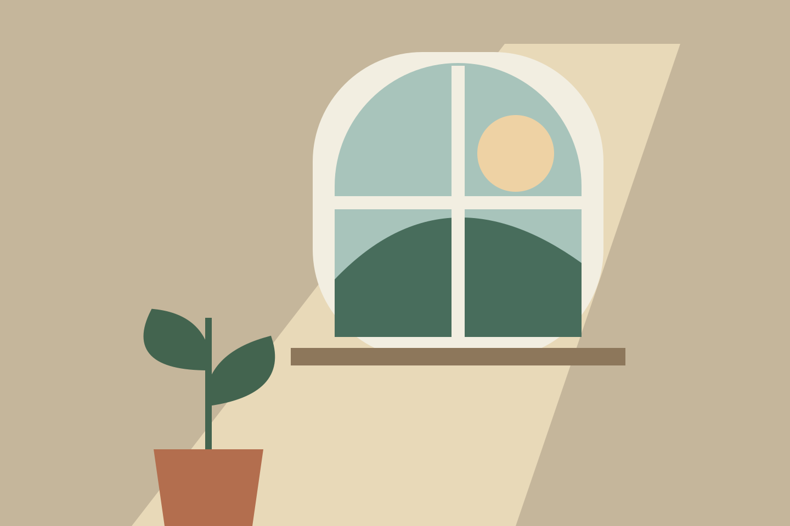

Some things belong together before there is a story to connect them. These are mine for now.

```ssb-media-spotlight


[Six seconds by the illustrated shore](/media/sample-shore-film.mp4 "video")

```

## A loose collection

Use **Grid** to see the collection together, or **Spotlight** to move through it one piece at a time.

The [gallery](/gallery/) has everything, with tags to narrow the view. [Four studies in light](/blog/four-studies-in-light/) tells the story behind the palette.
