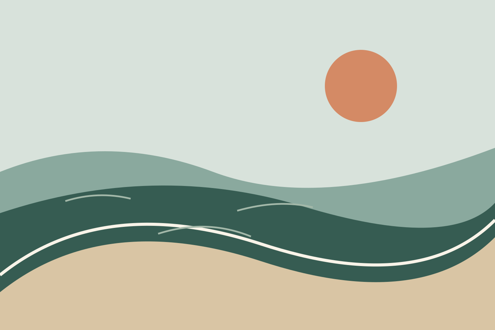
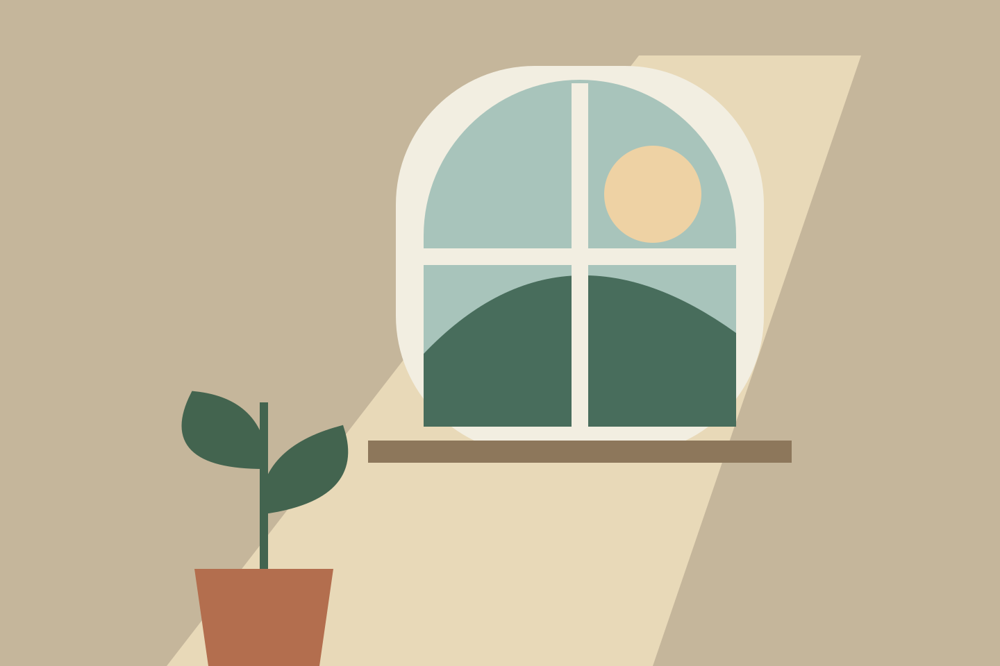
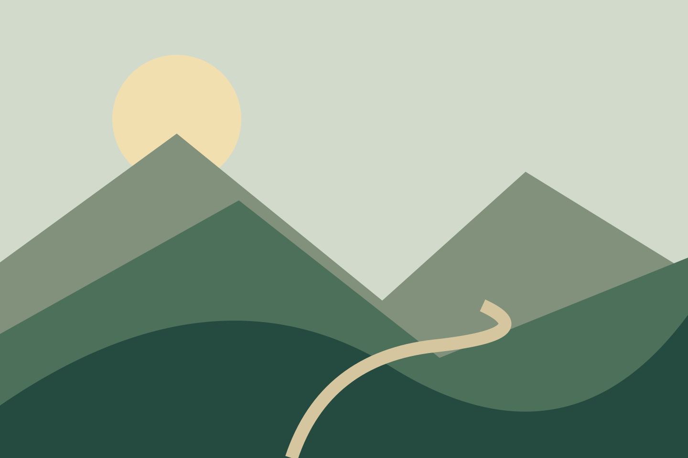

Welcome in. This is a sample corner of the internet: a journal to read, pictures to linger over, and a few things to try.

## Start somewhere

- **[Take the long way home](/blog/the-long-way-home/)** — a walk told in pictures and a short film.
- **[Look at the light](/daylight/)** — a small collection, with room to browse.
- **[Make ten minutes](/writing-room/)** — an uncluttered place to write.
- **[Keep a field guide](/field-guide/)** — three printable pages for your next slow afternoon.

## Three things, lately

A window at four. A notebook left open. The line where water meets land.

```ssb-media-grid



```

## Come back when you like

The [journal](/blog/) holds the longer stories. [Topics](/tags/) connect the loose threads. The [gallery](/gallery/) gathers the pictures and films in one place.

No hurry. There is always another page.
