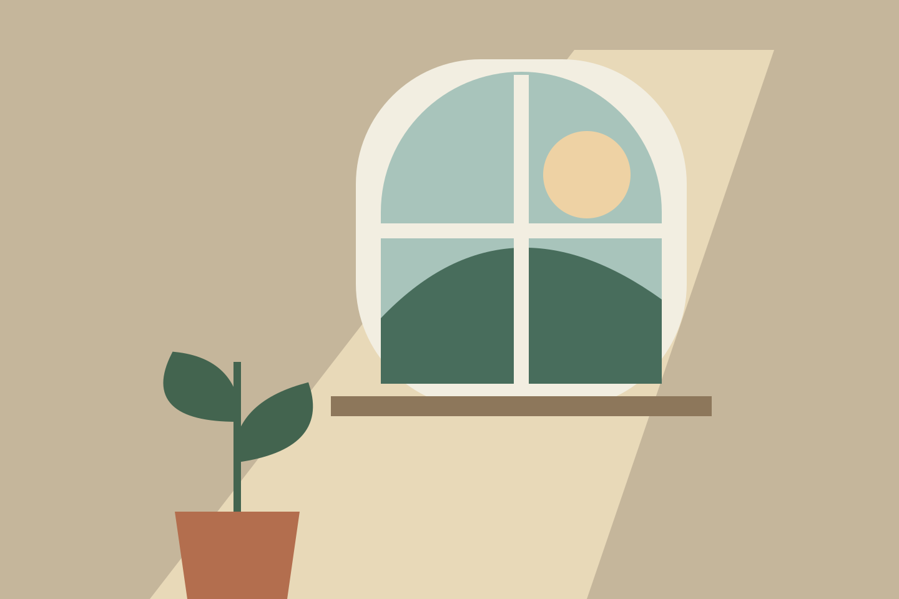
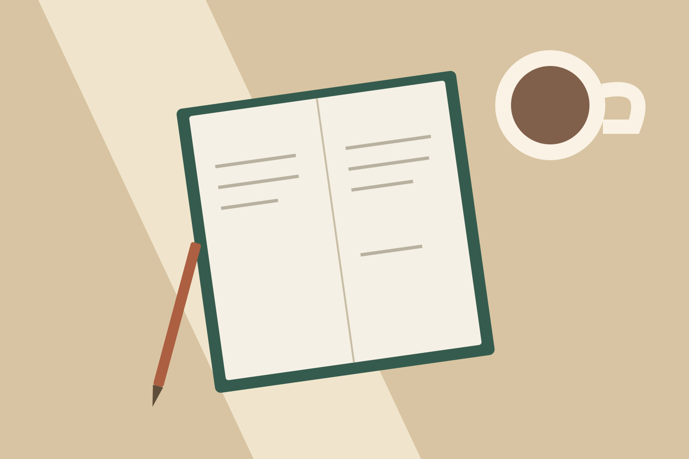
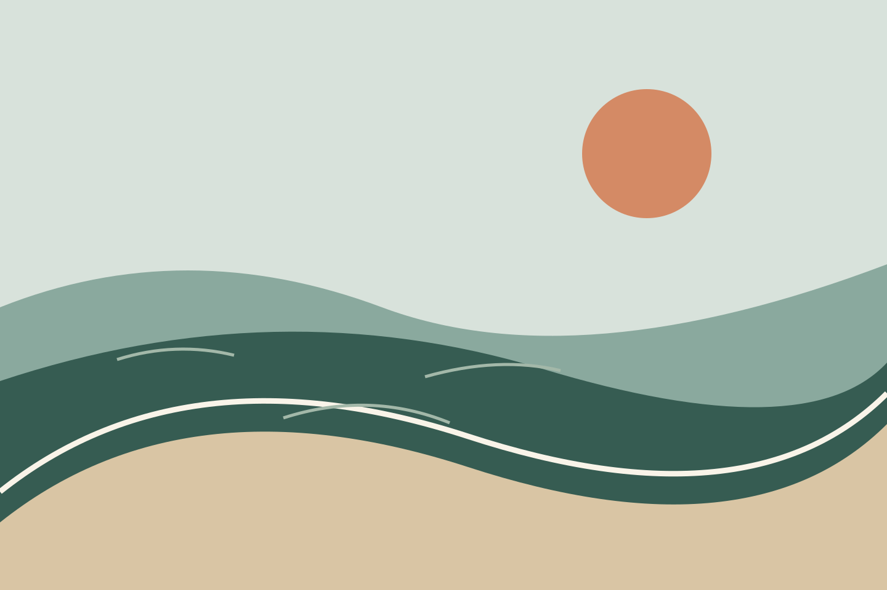

These drawings began as a rule: four colours, a few shapes, and no detail that did not earn its place.

```ssb-media-grid




```

The window feels still. The desk feels expectant. The shore seems to be leaving. The path seems to be arriving.

## What changed

The palette stayed nearly the same. The amount of empty space did not. Leaving more room around a shape made it feel less like an object and more like a place.

You can switch the collection to **Spotlight** to spend a moment with each drawing. The same images live in the [gallery](/gallery/?tag=daylight).

*Original sample illustrations, drawn for this site.*
